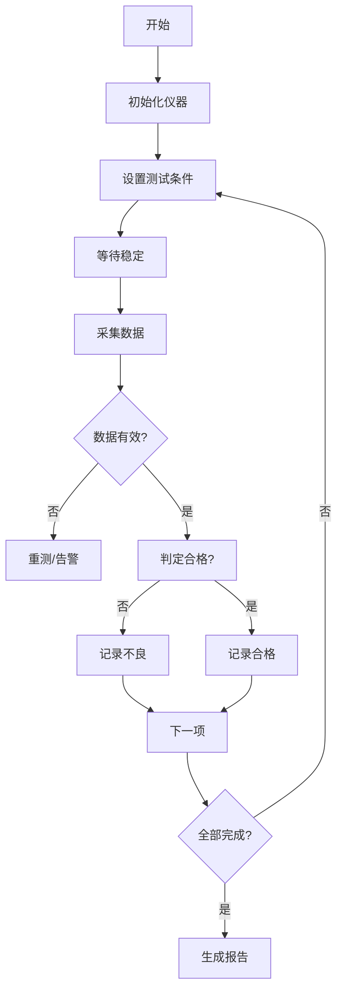

# 仪器仪表及产品核对表

> 本表针对**测量仪器**（万用表、示波器、电源、电子负载、功率分析仪、LCR、频谱仪等）
> 与**产品本身**（被测件 DUT / 被控产品）的核对。
> 与设备清单核对表的区别：本表聚焦"仪器的指令集、量程、精度、安全"与"产品规格"。

---

## 第一部分：仪器通信接口核对

### 1.1 仪器接口总览

| 仪器 | 品牌型号 | 接口 | 指令集 | 驱动/库 | 是否支持多客户端 | 备注 |
|---|---|---|---|---|---|---|
| 数字万用表 | | ☐ USB ☐ LAN ☐ GPIB ☐ RS232 | ☐ SCPI ☐ 私有 | | | |
| 直流电源 | | | | | | |
| 电子负载 | | | | | | |
| 示波器 | | | | | | |
| 信号发生器 | | | | | | |
| 功率分析仪 | | | | | | |
| 数据采集器 | | | | | | |
| 温控箱 | | | | | | |
| 频谱分析仪 | | | | | | |
| LCR 表 | | | | | | |
| 绝缘/耐压测试仪 | | | | | | |
| 其他 | | | | | | |

### 1.2 通信方式细节

| 项 | 内容 | 确认 |
|---|---|---|
| VISA 地址格式 | 如 `TCPIP0::192.168.1.5::inst0::INSTR` / `USB0::0x1234::0x5678::SN::INSTR` / `GPIB0::8::INSTR` | ☐ |
| 是否安装 NI-VISA / Keysight IO Libraries | 版本 ______ | ☐ |
| VISA 位数（32/64 位）与程序一致 | | ☐ |
| GPIB 卡型号与驱动 | | ☐ |
| 命令结束符 | ☐ `\n` ☐ `\r\n` ☐ `\r` | ☐ |
| 是否需设置超时 | ___ ms | ☐ |
| 是否需先 `*IDN?` 确认型号 | | ☐ |
| 是否需 `*CLS` 清状态 | | ☐ |
| 是否需 `*RST` 复位 | ⚠️ 会改变仪器状态，需评估 | ☐ |

### 1.3 SCPI 常用通用命令

| 命令 | 作用 | 使用场景 |
|---|---|---|
| `*IDN?` | 查询仪器身份 | 连接后必须确认，防止连错仪器 |
| `*RST` | 复位到出厂状态 | 测试开始前。⚠️ 会清空用户设置 |
| `*CLS` | 清除状态 | 每轮测试前 |
| `*OPC?` | 操作完成查询 | 同步等待 |
| `*OPC` | 设置完成标志 | |
| `*WAI` | 等待操作完成 | |
| `*ESR?` | 查询事件状态寄存器 | 错误诊断 |
| `*ESE` | 设置事件使能 | |
| `*SRE` | 设置服务请求使能 | |
| `*STB?` | 读状态字节 | 轮询状态 |
| `SYST:ERR?` | 查询错误队列 | **每个操作后建议查询** |

---

## 第二部分：仪器量程与精度核对

### 2.1 量程配置

| 仪器 | 参数 | 量程 | 分辨率 | 精度 | 备注 |
|---|---|---|---|---|---|
| | 电压 | | | | |
| | 电流 | | | | |
| | 电阻 | | | | |
| | 频率 | | | | |
| | 时间 | | | | |

### 2.2 精度与不确定度

- [ ] 仪器精度指标已获取（如 ±(0.05% + 3 digits)）
- [ ] 是否需要考虑温度系数
- [ ] 是否需要考虑长期漂移
- [ ] 是否需要校准证书？有效期
- [ ] 系统总不确定度是否满足产品测试要求（通常要求 ≤ 规格公差的 1/3 ~ 1/10）
- [ ] 是否需要定期自校准（如开机预热、零点校准）

### 2.3 采集速度与滤波

| 项 | 内容 | 确认 |
|---|---|---|
| 仪器的采样率范围 | | ☐ |
| 是否可设置 NPLC（积分周期） | ☐ 是（NPLC=___） ☐ 否 | ☐ |
| NPLC 与工频抑制关系 | 50Hz 电网需整数 NPLC | ☐ |
| 是否可设置数字滤波 | ☐ 是（类型 ___） ☐ 否 | ☐ |
| 是否可设置平均值次数 | ☐ 是（___次） ☐ 否 | ☐ |
| 单次测量耗时 | ___ ms（实测） | ☐ |
| 量程自动切换是否影响速度 | ☐ 是 ☐ 否 | ☐ |
| 是否需要固定量程以提高速度 | | ☐ |

> ⚠️ **关键性能点**：`NPLC` 越大精度越高但越慢。1 NPLC @ 50Hz = 20ms。若需 100 点/秒则必须降低 NPLC，精度会下降。

---

## 第三部分：仪器连接与初始化序列

### 3.1 上电与连接顺序

```
1. 仪器上电并预热（___ 分钟，高精度测量必须）
2. 上位机启动
3. 逐个连接仪器（VISA 打开）
4. 发送 *IDN? 确认型号与序列号
5. 发送 *CLS 清状态
6. 配置测量参数（量程、NPLC、滤波）
7. 进入就绪状态
```

- [ ] 是否需预热？预热时间 ___ 分钟
- [ ] 预热期间是否禁止测量
- [ ] 连接失败的重试次数与间隔
- [ ] 型号不匹配时是否拒绝启动（防连错仪器）
- [ ] 序列号是否需记录（追溯要求）

### 3.2 序列号与型号校验

| 仪器 | 预期型号 | 预期序列号 | 实测 *IDN? 返回 |
|---|---|---|---|
| | | | |

> 现场可能存在同型号多台仪器，**必须通过序列号区分**，避免连错仪器导致数据张冠李戴。

---

## 第四部分：测量数据核对

### 4.1 数据类型与时序

| 项 | 内容 | 确认 |
|---|---|---|
| 返回数据格式 | ☐ ASCII ☐ 二进制 | ☐ |
| ASCII 小数位 | ___ 位 | ☐ |
| 二进制字节序 | ☐ 大端 ☐ 小端 | ☐ |
| 单次读取时间 | ___ ms | ☐ |
| 是否需要触发（Trigger） | ☐ 是（触发源 ______） ☐ 否 | ☐ |
| 是否需要等待完成（*OPC?） | | ☐ |
| 是否有数据就绪状态位 | | ☐ |
| 多值返回时的分隔符 | ☐ 逗号 ☐ 分号 ☐ 空格 | ☐ |

### 4.2 数据有效性

- [ ] 是否检查返回值的合法性（NaN / Overflow / 超量程）
- [ ] 超量程时的返回值已确认（如 9.9E37）
- [ ] 是否有数据质量标识
- [ ] 数据与实际物理量的一致性已验证（用标准源比对）
- [ ] 是否有已知的系统性偏差需要补偿
- [ ] 单位换算是否正确（mV/V, mA/A, kΩ/Ω）

### 4.3 数据比对验证

| 验证项 | 标准源/参考值 | 仪器读数 | 偏差 | 结论 |
|---|---|---|---|---|
| | | | | ☐ |
| | | | | ☐ |

---

## 第五部分：测试流程核对

### 5.1 测试流程定义



- [ ] 测试项清单是否完整
- [ ] 每项的测试条件（电压、电流、温度、时间）是否明确
- [ ] 每项是否需要稳定等待时间？时长
- [ ] 每项是否需要多次测量取平均？次数
- [ ] 判定标准（上下限）是否明确
- [ ] 不良品的处理流程
- [ ] 重测规则（允许重测次数、条件）
- [ ] 测试节拍要求（单个产品 ___ 秒）

### 5.2 测试条件设置

| 测试项 | 条件 | 稳定时间 | 采样次数 | 上限 | 下限 | 判定 |
|---|---|---|---|---|---|---|
| | | | | | | |

---

## 第六部分：产品（DUT）核对

### 6.1 产品基本信息

| 项 | 内容 |
|---|---|
| 产品名称 | |
| 产品型号 | |
| 版本/批次 | |
| 额定参数 | |
| 供电要求 | |
| 接口定义 | |
| 引脚定义 | |
| 通信协议（若产品自身有通信） | |
| 固件版本 | |

### 6.2 产品通信协议（若产品自身可通信）

| 项 | 内容 | 确认 |
|---|---|---|
| 通信接口 | | ☐ |
| 波特率/地址 | | ☐ |
| 协议类型 | | ☐ |
| 命令集文档 | | ☐ |
| 是否有握手/认证 | | ☐ |
| 是否需固件版本兼容性检查 | | ☐ |
| 是否有测试模式/工厂模式 | | ☐ |
| 是否需写入序列号/校准参数 | | ☐ |
| 写入的序列号规则 | | ☐ |
| 写入后是否需要验证 | | ☐ |

### 6.3 产品规格与判定标准

| 参数 | 规格标称值 | 公差 | 测试方法 | 判定标准 | 单位 |
|---|---|---|---|---|---|
| | | | | | |

### 6.4 产品状态与安全

- [ ] 产品是否有高压部分？测试时的防护措施
- [ ] 产品是否有高温部分？
- [ ] 产品测试时是否需要夹具？夹具的通信/IO 接口
- [ ] 产品是否需要老化/预热？时长
- [ ] 产品故障时是否可能损坏仪器？保护措施
- [ ] 是否需防反接保护
- [ ] 产品是否需要冷却后才能测试
- [ ] 产品是否有静电敏感器件？ESD 防护

---

## 第七部分：追溯与记录核对

- [ ] 产品序列号如何采集（扫码枪/手工/从产品读）
- [ ] 序列号与测试数据的关联方式
- [ ] 测试原始数据是否保存（原始值 vs 处理值）
- [ ] 数据保存时长要求（客户/行业要求）
- [ ] 是否需要生成测试报告？格式
- [ ] 报告是否需打印/电子签名
- [ ] 不良数据是否需要图片/波形附件
- [ ] 测试人员信息是否记录
- [ ] 测试设备序列号是否随数据记录
- [ ] 校准有效期是否校验（过期仪器拒绝测试或告警）
- [ ] 数据是否需上传 MES/QMS
- [ ] 上传失败的补传机制
- [ ] 数据是否需符合特定行业标准（IATF/GMP/ISO17025）

---

## 第八部分：仪器维护与异常

- [ ] 仪器校准周期与到期提醒
- [ ] 仪器故障时的替换流程
- [ ] 仪器通信异常的自动恢复
- [ ] 仪器返回错误时的处理（查 SYST:ERR?）
- [ ] 是否需要记录仪器使用次数/时长
- [ ] 仪器掉电后的恢复流程
- [ ] 是否需支持仪器热插拔
- [ ] 多台同类仪器的主备切换

---

## 签字确认

| 角色 | 姓名 | 单位 | 日期 | 签字 |
|---|---|---|---|---|
| 上位机开发 | | | | |
| 测试工程师 | | | | |
| 产品工程师 | | | | |
| 质量负责人 | | | | |
