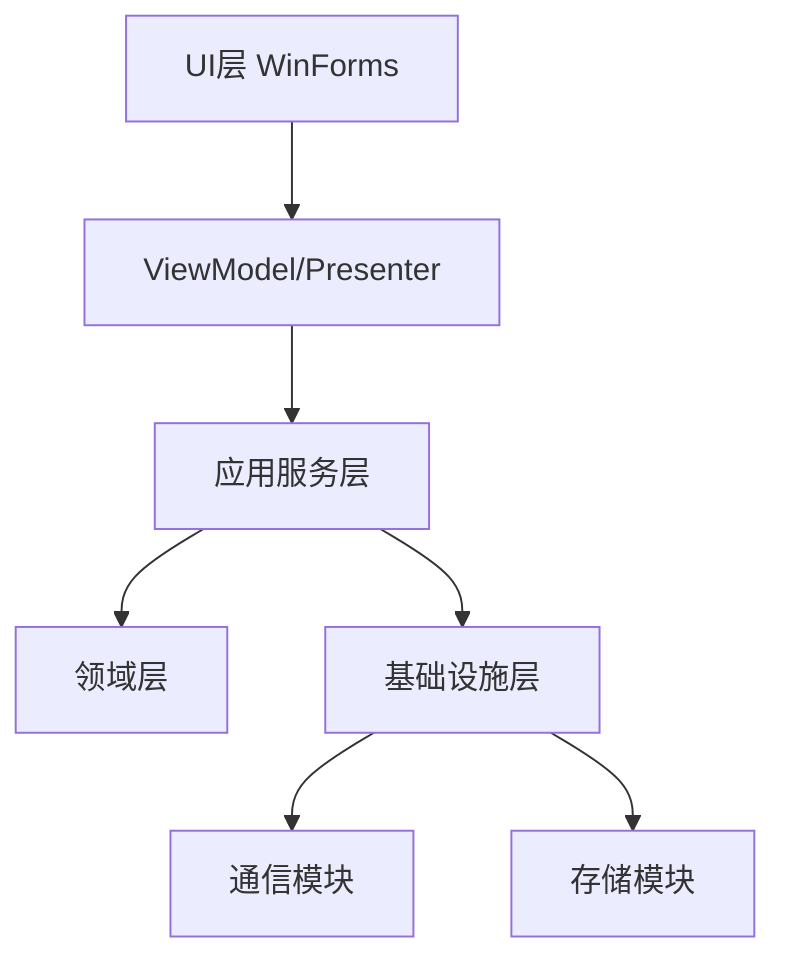
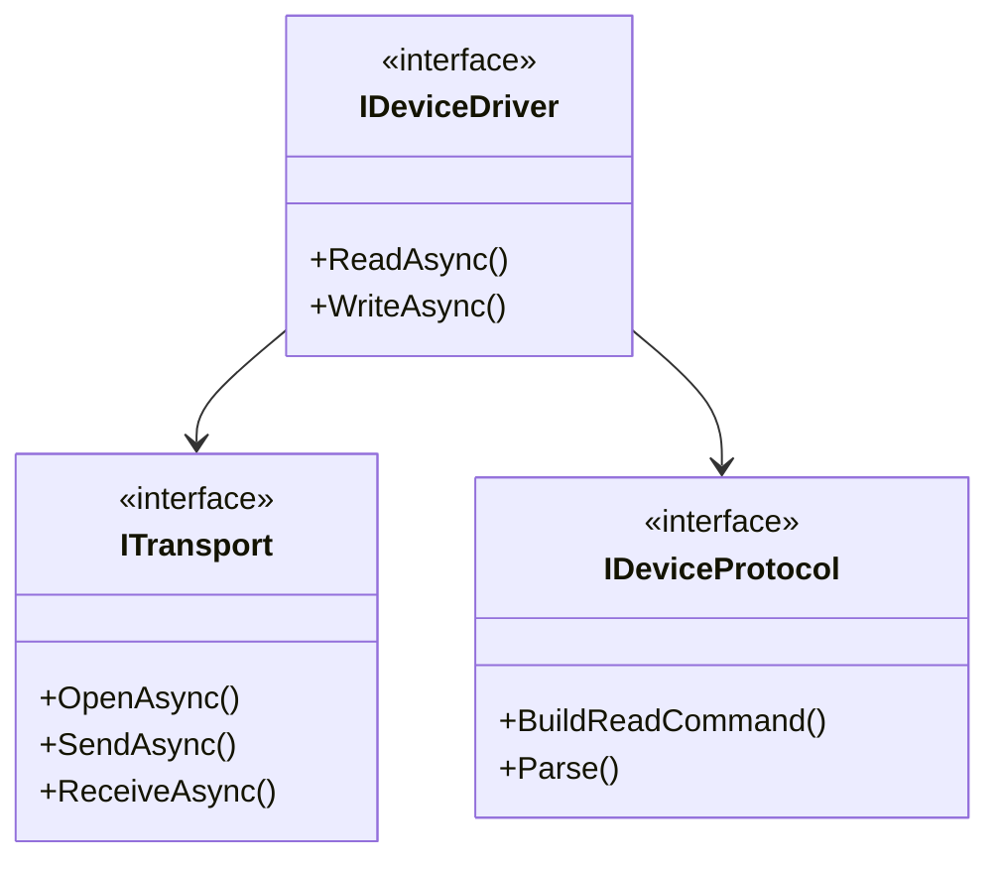
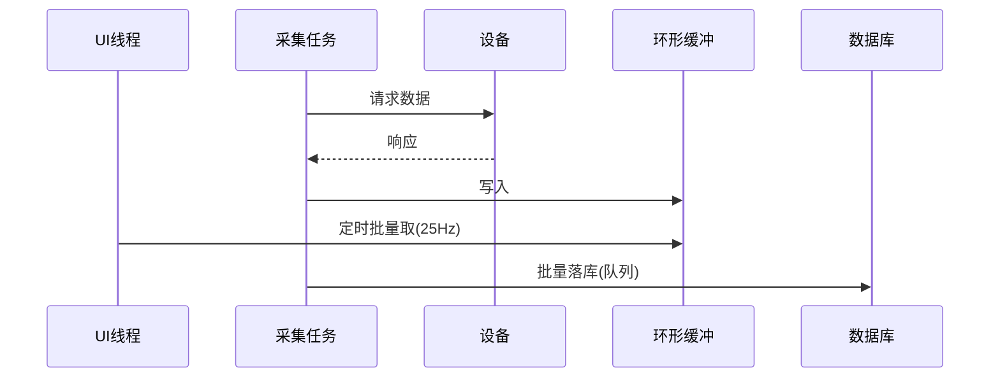
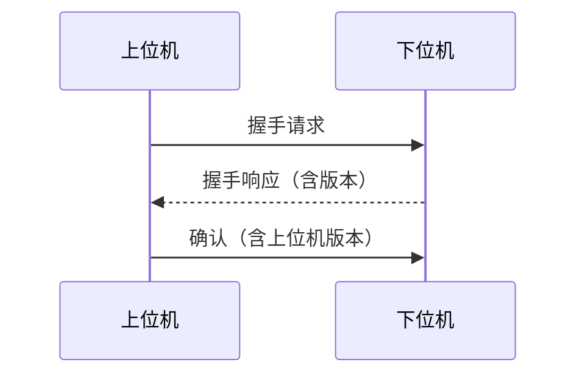

# 上位机软件开发文档体系规范

## 1. 文档清单（强制）

每个上位机项目必须维护以下 7 份 Markdown 文档，存放于项目根目录 `docs/`：

| 编号 | 文件 | 作用 | 更新时机 |
|---|---|---|---|
| 00 | `00-软件需求规格说明书.md` | 需求基线 | 需求变更时 |
| 01 | `01-系统设计说明书.md` | 架构与技术方案 | 设计变更时 |
| 02 | `02-接口与通信协议说明书.md` | 上下位机契约 | 协议变更时 |
| 03 | `03-电气与仪器核对表.md` | 硬件核对结果 | 硬件确认/变更时 |
| 04 | `04-测试与验收方案.md` | 测试用例与验收标准 | 每阶段测试后 |
| 05 | `05-开发进度日志.md` | **每轮对话追加** | 每轮对话后 |
| 06 | `06-问题与风险台账.md` | 问题跟踪 | 发现/关闭问题时 |

**使用 `scripts/init_project_docs.py` 一键生成全部骨架。**

## 2. 00-软件需求规格说明书 模板

```markdown
# <项目名称> 软件需求规格说明书

| 项目 | 内容 |
|---|---|
| 项目名称 | |
| 文档版本 | v0.1 |
| 编制日期 | |
| 编制人 | |
| 客户/使用方 | |
| 适用阶段 | |

## 1. 项目背景与目标

### 1.1 业务背景
（这段设备/产线现在怎么工作，为什么要做上位机）

### 1.2 项目目标
（3-5 条可衡量的目标，如"替代人工记录，数据自动入库"）

### 1.3 不在本次范围内
（明确划出边界，防止需求蔓延）

## 2. 系统组成

### 2.1 硬件构成
| 序号 | 设备名称 | 型号 | 数量 | 接口 | 备注 |
|---|---|---|---|---|---|
| 1 | | | | | |

### 2.2 软件构成
| 模块 | 功能 | 运行环境 |
|---|---|---|
| | | |

## 3. 功能需求

### FR-001 <功能名称>
- **描述**：
- **输入**：
- **处理**：
- **输出**：
- **优先级**：必须 / 重要 / 期望
- **验收标准**：（可测量、可观测）

（按此格式逐条列出所有功能需求）

## 4. 非功能需求

### NFR-001 性能
- 采集周期 ≤ ___ ms
- 界面响应 ≤ ___ ms
- 支持设备数量 ≥ ___
- 单日数据量 ≈ ___ 条

### NFR-002 可靠性
- 连续运行 ≥ ___ 小时无故障
- 单设备通信中断不影响其他设备
- 断电后数据不丢失（落盘策略）

### NFR-003 可用性
- 操作人员培训时间 ≤ ___ 小时
- 所有操作有明确反馈
- 关键操作有二次确认

### NFR-004 可维护性
- 参数外置，现场可修改
- 日志可查，支持导出诊断包
- 支持远程协助

### NFR-005 安全
- 操作权限分级
- 关键操作留痕
- 数据防篡改

## 5. 运行环境

| 项 | 要求 |
|---|---|
| 操作系统 | Windows 7 / 10 / 11（具体版本） |
| CPU | |
| 内存 | |
| 硬盘 | |
| 显示器分辨率 | |
| 网络 | |
| .NET Framework | 4.8 |
| 其他依赖 | |

## 6. 界面需求
（界面草图、页面清单、导航结构）

## 7. 数据需求
- 采集哪些数据
- 保存多久
- 如何导出
- 是否需要上传 MES/云端

## 8. 用户与权限
| 角色 | 权限 |
|---|---|
| 操作员 | |
| 工程师 | |
| 管理员 | |

## 9. 待确认事项（⚠️ 必须清零后才能进入编码）
| 序号 | 待确认内容 | 影响 | 责任人 | 状态 |
|---|---|---|---|---|
| 1 | | | | ⚠️待确认 |

## 10. 需求变更记录
| 版本 | 日期 | 变更内容 | 原因 | 影响范围 |
|---|---|---|---|---|
```

## 3. 01-系统设计说明书 模板

```markdown
# <项目名称> 系统设计说明书

## 1. 架构总览

### 1.1 分层结构
（嵌入 Mermaid 图）



### 1.2 技术选型与理由
| 技术点 | 选型 | 理由 | 备选方案 |
|---|---|---|---|
| UI 框架 | WinForms | 现场兼容性好、开发快 | WPF |
| 目标框架 | .NET Framework 4.8 | 客户环境已有、无需额外安装 | .NET 8 |
| DI | Microsoft.Extensions.DependencyInjection | 轻量、生态好 | 手写 |
| 日志 | NLog | 配置文件外置、性能好 | Serilog |
| 数据库 | SQLite | 零部署、单机足够 | SQL Server |
| 通信库 | 自研 + S7.Net + OPC UA官方库 | | |

## 2. 解决方案结构

```
（目录树，见 assets/templates/project-tree.md）
```

## 3. 模块设计

### 3.1 <模块名>
- **职责**：
- **依赖**：
- **对外接口**：
- **关键实现要点**：
- **异常处理**：

（逐模块展开）

## 4. 通信设计

### 4.1 设备清单与协议
| 设备 | 协议 | 地址/端口 | 周期 | 超时 | 重试 |
|---|---|---|---|---|---|
| | | | | | |

### 4.2 抽象层次


### 4.3 数据流


## 5. 并发与线程模型
| 任务 | 类型 | 周期 | 取消方式 |
|---|---|---|---|
| 采集任务 | Task + CancellationToken | | |
| 接收循环 | 独立 Task | 持续 | |
| 落库任务 | BlockingCollection 消费者 | 持续 | |
| UI 刷新 | WinForms.Timer | 100ms | |

## 6. 数据库设计

### 6.1 表结构
```sql
CREATE TABLE Sample (
    Id          INTEGER PRIMARY KEY AUTOINCREMENT,
    DeviceId    TEXT NOT NULL,
    TagName     TEXT NOT NULL,
    Value       REAL NOT NULL,
    Quality     INTEGER DEFAULT 0,
    Timestamp   INTEGER NOT NULL   -- Unix ms
);
CREATE INDEX idx_sample_time ON Sample(Timestamp);
```

### 6.2 数据量估算与保留策略
- 单条记录 ≈ ___ 字节
- 日增 ≈ ___ 条 / ___ MB
- 保留策略：滚动删除 ___ 天前数据 / 分区表 / 归档

## 7. 异常与容错设计
（设备级、服务级、应用级三层防线；重连策略；降级方案）

## 8. 部署设计
（安装包、配置文件、数据库初始化、注册表/服务、现场部署步骤）

## 9. 设计决策记录（ADR）
| 编号 | 决策 | 备选方案 | 理由 | 影响 |
|---|---|---|---|---|
| ADR-001 | | | | |
```

## 4. 02-接口与通信协议说明书 模板

> ⚠️ **这份文档是上下位机对接的唯一契约。** 必须发给下位机工程师双方确认签字。

```markdown
# <项目名称> 接口与通信协议说明书

## 1. 通信概览
| 项 | 内容 |
|---|---|
| 物理层 | RS485 / 以太网 / CAN |
| 协议 | Modbus RTU / 自定义 / OPC UA |
| 上位机角色 | 主站 / 客户端 |
| 通信周期 | |

## 2. 链路参数
| 参数 | 值 |
|---|---|
| 波特率 / 端口 | |
| 数据位/停止位/校验 | |
| 本机地址 / 从站地址 | |
| 超时 | |
| 重试次数 | |

## 3. 报文格式

### 3.1 通用帧结构
| 字段 | 长度 | 说明 |
|---|---|---|
| 帧头 | 2B | 固定 0xAA55 |
| 长度 | 2B | 小端，不含帧头与校验 |
| 命令码 | 1B | |
| 数据 | nB | |
| CRC16 | 2B | 多项式 0xA001，低字节在前 |

### 3.2 字节序约定
- 多字节整数：**大端 / 小端**（明确写出）
- 32 位浮点：IEEE754，寄存器顺序 ___
- 字符串：ASCII / UTF-8，定长 ___ 字节，不足补 0x00 / 0x20

### 3.3 校验方式
（CRC16 / 累加和 / 无校验；给出计算示例与实测报文）

## 4. 命令码清单
| 命令码 | 名称 | 方向 | 请求数据 | 响应数据 |
|---|---|---|---|---|
| 0x01 | 读实时数据 | 上→下 | | |
| 0x02 | 写参数 | 上→下 | | |
| 0x81 | 主动上报 | 下→上 | | |

## 5. 标签/寄存器映射表

| 序号 | 标签名 | 地址 | 功能码 | 数据类型 | 位偏移 | 量纲/系数 | 单位 | 读写 | 范围 | 说明 |
|---|---|---|---|---|---|---|---|---|---|---|
| 1 | | | | | | | | R/W | | |

## 6. 通信流程

### 6.1 上电握手


### 6.2 数据采集流程
（时序图）

### 6.3 参数下发流程
（时序图，含确认与回读）

### 6.4 异常处理
| 异常 | 下位机行为 | 上位机行为 |
|---|---|---|
| 校验错误 | 丢弃不响应 | 超时重试 ___ 次后告警 |
| 地址越界 | 返回异常码 | 记录日志并告警 |
| 设备忙 | 返回 0x06 | 延时 ___ ms 后重试 |

## 7. 实测报文样例
```
请求: AA 55 05 00 01 01 00 00 3E 4B
响应: AA 55 0B 00 81 01 64 00 00 00 00 00 00 7A 2F
```

## 8. 版本兼容性
| 协议版本 | 固件版本 | 上位机版本 | 兼容性 |
|---|---|---|---|
| v1.0 | | | |

## 9. 双方确认
| 角色 | 姓名 | 日期 | 签字 |
|---|---|---|---|
| 上位机开发 | | | |
| 下位机开发 | | | |
| 项目负责人 | | | |
```

## 5. 05-开发进度日志 机制（本技能核心约定）

### 5.1 文件头模板

```markdown
# <项目名称> 开发进度日志

> 本文件为**追加式**记录，禁止覆盖历史内容。
> 每当完成一个有实质产出的对话轮次，必须追加一条记录。

## 日志格式约定

每条记录包含：
- 时间戳（YYYY-MM-DD HH:mm）
- 本次目标
- 完成内容（具体、可核对）
- 产出文件（带路径）
- 关键决策及理由
- 遗留问题 / 下一步

---
```

### 5.2 单条记录模板

```markdown
## [2026-10-14 09:30] 完成设备通信层抽象与串口实现

- **本次目标**：建立 ITransport / IDeviceProtocol / IDeviceDriver 三层抽象，并完成 SerialTransport 实现
- **完成内容**：
  - 定义三层通信抽象接口，写入 SolutionName.Comm.Abstractions
  - 实现 SerialTransport，支持 RS232/RS485，含方向控制与超时重传
  - 实现 FrameDelimiterParser 处理粘包
  - 新增 SimulatedTransport 用于无硬件开发
- **产出文件**：
  - `src/SolutionName.Comm/Abstractions/ITransport.cs`
  - `src/SolutionName.Comm/Serial/SerialTransport.cs`
  - `src/SolutionName.Comm/Serial/FrameDelimiterParser.cs`
  - `tests/SolutionName.Comm.Tests/SimulatedTransport.cs`
- **关键决策及理由**：
  - 决定统一用 `BeginInvoke` 而非 `Invoke`，避免后台线程阻塞导致死锁
  - 决定 `ReadBufferSize` 设为 4096（默认 1024 会截断长报文）
  - 决定 RS485 总线级加 `SemaphoreSlim` 串行化，防止多设备碰撞
- **遗留问题 / 下一步**：
  - ⚠️ 设备从站地址与波特率仍需客户确认（阻塞项）
  - 下一步：实现 Modbus RTU 协议层与批量读取规划器
- **文档同步**：已同步 02-接口与通信协议说明书 第 3.2 节（字节序约定）
```

### 5.3 落盘命令

使用 `scripts/append_progress.py`：

```bash
python append_progress.py <项目docs目录> "<标题>" \
    --goal "本次目标" \
    --done "完成内容" \
    --files "产出文件" \
    --decisions "关键决策" \
    --next "遗留问题"
```

或直接使用 Edit 工具向文件末尾追加。

### 5.4 强制要求

1. **禁止只写"已完成"**。必须写清完成了什么、在哪、依据是什么。
2. **必须记录"关键决策及理由"**。三个月后回头看，理由比结论重要。
3. **必须写"遗留问题 / 下一步"**。这是下次对话的上下文入口。
4. **若修改了需求/接口，必须同步更新 00/01/02 文档**，并在日志中标注。
5. **不确定的事标记 ⚠️**，不要写成已确认。

## 6. 06-问题与风险台账 模板

```markdown
# <项目名称> 问题与风险台账

## 一、未关闭问题

| 编号 | 类型 | 描述 | 影响 | 优先级 | 负责人 | 提出日期 | 状态 |
|---|---|---|---|---|---|---|---|
| ISS-001 | 硬件 | | | 高 | | | 待解决 |

类型：硬件 / 软件 / 协议 / 需求 / 现场 / 文档
优先级：阻塞 / 高 / 中 / 低
状态：待解决 / 处理中 / 待验证 / 已关闭 / 不解决

## 二、风险登记

| 编号 | 风险描述 | 概率 | 影响 | 应对措施 | 触发条件 |
|---|---|---|---|---|---|
| RSK-001 | | 高/中/低 | | | |

## 三、已关闭问题（归档）

| 编号 | 描述 | 解决方案 | 关闭日期 |
|---|---|---|---|
```

## 7. 文档维护纪律

| 规则 | 说明 |
|---|---|
| 单一事实来源 | 每个信息只在一处维护，其他地方用引用 |
| 版本标注 | 每份文档头部标注版本与日期 |
| 变更留痕 | 需求/接口变更必须记录变更记录表 |
| 待确认清单 | `00` 文档第 9 节的待确认事项必须清零才能进入编码 |
| 禁止事后补文档 | 文档随开发同步产出，不允许"先写代码后补文档" |
| 图表用 Mermaid | 保证 diff 可读、可版本控制 |
